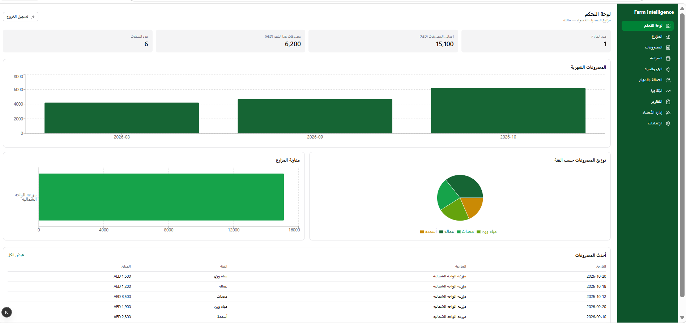
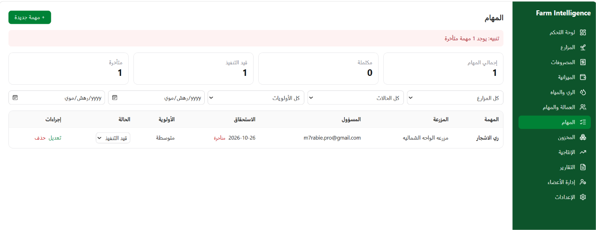
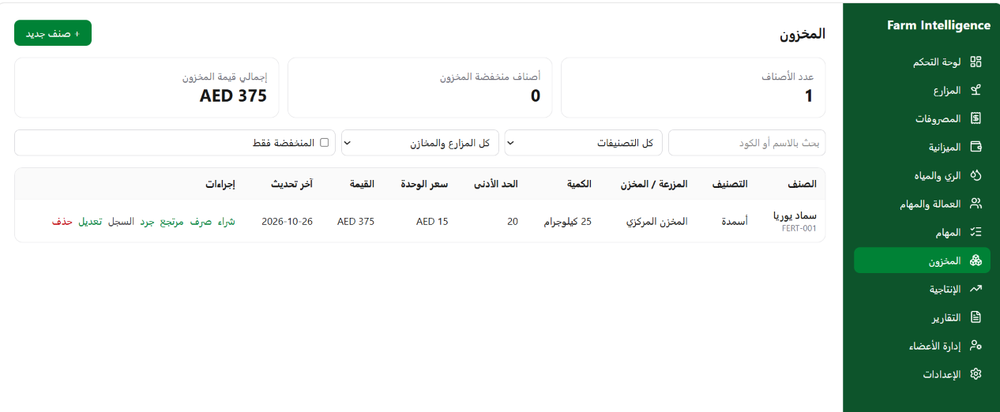

# Farm Intelligence

منصة سحابية متعددة المؤسسات لإدارة وتحليل بيانات المزارع: تسجيل المزارع والمصروفات، وإدارة المهام والمخزون، ولوحة مؤشرات ورسوم بيانية، مع عزل كامل لبيانات كل مؤسسة.

**الموقع المباشر:** https://farm-intelligence-black.vercel.app

## المميزات

- تسجيل الدخول وإنشاء الحساب، مع تأكيد البريد وإعادة تعيين كلمة المرور
- مؤسسات متعددة، وبيانات كل مؤسسة معزولة عن غيرها (Row Level Security)
- إضافة وتعديل وحذف المزارع
- تسجيل وتعديل وحذف المصروفات حسب الفئة (عمالة، مياه وري، أسمدة، ...)
- استيراد المصروفات من ملفات CSV وExcel: معاينة قبل الحفظ، والتحقق من الصفوف وعرض الأخطاء، ومنع تكرار الصفوف الموجودة
- مؤشرات إجمالية ورسوم بيانية شهرية وحسب الفئة والمزرعة
- رسائل خطأ واضحة (مثل منع حذف مزرعة عليها مصروفات)
- ميزانية شهرية لكل مزرعة، مع شريط تقدم وصفحة مقارنة الميزانية بالمصروف الفعلي
- تقارير شهرية: ملخص المصروفات حسب الفئة لآخر 6 شهور، مع تصدير CSV
- **المهام:** إسناد مهام للأعضاء، أولويات (منخفضة، متوسطة، عالية، عاجلة)، حالات (جديدة، قيد التنفيذ، مكتملة، ملغاة)، فلاتر حسب المزرعة والحالة والأولوية وتاريخ الاستحقاق، وتنبيهات للمهام المتأخرة والمستحقة اليوم
- **المخزون:** أصناف بتصنيفات ووحدات، ورصيد لا يتغير إلا من خلال حركات (شراء، صرف، مرتجع، تسوية جرد)، وسجل حركات ثابت لا يقبل التعديل أو الحذف، وتنبيه عند الوصول للحد الأدنى، وقيمة إجمالية للمخزون
- صفحات متخصصة للري والمياه، والعمالة، والإنتاجية
- تصميم بقائمة جانبية ثابتة وصفحات منفصلة لكل قسم، ويعمل على الموبايل بقائمة منسدلة
- حماية من الضغط المزدوج على نماذج الحفظ (المصروفات، المهام، المخزون)

## الأدوار والصلاحيات

الأدوار المتاحة: `owner`, `farm_manager`, `accountant`, `supervisor`, `analyst`, `viewer`.

| الصفحة | القراءة | الكتابة |
| --- | --- | --- |
| المصروفات | أعضاء المؤسسة | owner, farm_manager, accountant |
| المهام | أعضاء المؤسسة | owner, farm_manager (والمسؤول عن المهمة يغيّر حالتها فقط) |
| المخزون | أعضاء المؤسسة | أصناف: owner, farm_manager — حركات: owner, farm_manager, accountant — تسوية الجرد: owner, farm_manager |
| الأعضاء | أعضاء المؤسسة | تغيير الأدوار: owner |

تُفرض هذه الصلاحيات على مستوى قاعدة البيانات عبر سياسات RLS، وليس في الواجهة فقط.

## التقنيات

- **الواجهة:** Next.js (App Router) + React + TypeScript + Tailwind CSS
- **الخلفية وقاعدة البيانات:** Supabase (Auth + PostgreSQL + RLS)
- **النشر:** Vercel (نشر تلقائي مع كل `git push`)

## هيكل البيانات

- `organizations` و`organization_members`: المؤسسات وأعضاؤها
- `farms`: المزارع التابعة لكل مؤسسة
- `expenses`: المصروفات المرتبطة بالمزارع (العملة الافتراضية AED)
- `farm_budgets`: الميزانية الشهرية لكل مزرعة
- `tasks`: المهام المرتبطة بالمؤسسة والمزرعة والمسؤول
- `inventory_items`: أصناف المخزون (الكمية تُحسب من الحركات ولا تُعدَّل مباشرة)
- `inventory_movements`: سجل حركات المخزون (إضافة فقط، بدون تعديل أو حذف)
- دالة `create_organization` (RPC) لإنشاء مؤسسة وربط منشئها بها
- ملفات SQL موجودة في مجلد `supabase/`، والمهاجرات (migrations) في `supabase/migrations/` (`001_tasks.sql` للمهام، و`002_inventory.sql` للمخزون)

## التشغيل محليًا

1. تثبيت الحزم:

```bash
npm install
```

2. إنشاء ملف `.env.local` بناءً على `.env.local.example` وإضافة مفاتيح مشروع Supabase.

3. تشغيل المشروع:

```bash
npm run dev
```

ثم افتح http://localhost:3000

## إعدادات Supabase المطلوبة

في Authentication ثم URL Configuration:

- **Site URL:** رابط الموقع المنشور
- **Redirect URLs:** رابط الموقع مع `/**` وكذلك

لتجهيز قاعدة بيانات جديدة: شغّل ملفات `supabase/` ثم ملفات `supabase/migrations/` بالترتيب من SQL Editor.

## خطة التطوير

- [x] المصادقة والمؤسسات والمزارع والمصروفات
- [x] الرسوم البيانية
- [x] تعديل وحذف المزارع والمصروفات
- [x] إعادة تعيين كلمة المرور
- [x] دعوة مستخدمين بأدوار
- [x] فلاتر وتصدير CSV
- [x] إخفاء الأزرار والنماذج حسب دور المستخدم
- [x] شاشة الأعضاء: عرض أعضاء المؤسسة وتغيير أدوارهم (للـ owner فقط)
- [x] دعوة أعضاء بالإيميل (Edge Function + SMTP من Brevo)
- [x] ميزانية شهرية لكل مزرعة مع مقارنتها بالمصروف الفعلي
- [x] إعادة تصميم الواجهة بقائمة جانبية وصفحات منفصلة
- [x] تقارير شهرية حسب الفئة مع تصدير CSV
- [x] واجهة متجاوبة مع الموبايل
- [x] استيراد المصروفات من CSV وExcel مع منع التكرار
- [x] المهام: إسناد وأولويات وفلاتر وتنبيهات
- [x] المخزون: حركات وتسوية جرد وسجل ثابت وتنبيه الحد الأدنى
- [x] مراجعة RLS على كل الجداول، وحماية الضغط المزدوج على النماذج
- [x] جدولة تلقائية تمنع إيقاف قاعدة بيانات Supabase المجانية
- [ ] مراجعة أمنية شاملة واختبارات قبل الاستخدام التجاري

## Screenshots






