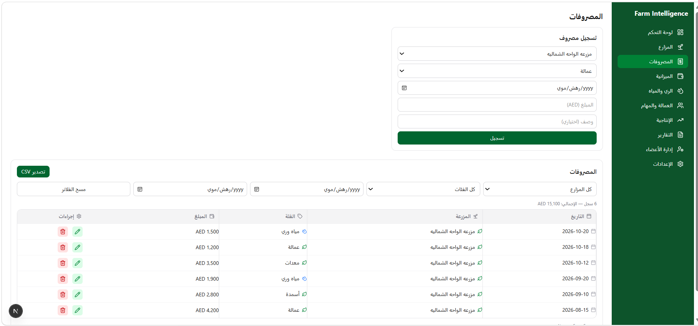

# Farm Intelligence

منصة سحابية متعددة المؤسسات لإدارة وتحليل بيانات المزارع: تسجيل المزارع والمصروفات، ولوحة مؤشرات ورسوم بيانية، مع عزل كامل لبيانات كل مؤسسة.

**الموقع المباشر:** https://farm-intelligence-black.vercel.app

## المميزات

- تسجيل الدخول وإنشاء الحساب، مع تأكيد البريد وإعادة تعيين كلمة المرور
- مؤسسات متعددة، وبيانات كل مؤسسة معزولة عن غيرها (Row Level Security)
- إضافة وتعديل وحذف المزارع
- تسجيل وتعديل وحذف المصروفات حسب الفئة (عمالة، مياه وري، أسمدة، ...)
- مؤشرات إجمالية ورسوم بيانية شهرية وحسب الفئة والمزرعة
- رسائل خطأ واضحة (مثل منع حذف مزرعة عليها مصروفات)
- ميزانية شهرية لكل مزرعة، مع شريط تقدم وصفحة مقارنة الميزانية بالمصروف الفعلي
- تقارير شهرية: ملخص المصروفات حسب الفئة لآخر 6 شهور، مع تصدير CSV
- صفحات متخصصة للري والمياه، والعمالة، والإنتاجية
- تصميم بقائمة جانبية ثابتة وصفحات منفصلة لكل قسم

## التقنيات

- **الواجهة:** Next.js (App Router) + React + TypeScript + Tailwind CSS
- **الخلفية وقاعدة البيانات:** Supabase (Auth + PostgreSQL + RLS)
- **النشر:** Vercel (نشر تلقائي مع كل `git push`)

## هيكل البيانات

- `organizations` و`organization_members`: المؤسسات وأعضاؤها
- `farms`: المزارع التابعة لكل مؤسسة
- `expenses`: المصروفات المرتبطة بالمزارع (العملة الافتراضية AED)
- `farm_budgets`: الميزانية الشهرية لكل مزرعة
- دالة `create_organization` (RPC) لإنشاء مؤسسة وربط منشئها بها
- ملفات SQL موجودة في مجلد `supabase/`

## التشغيل محليًا

1. تثبيت الحزم:

```bash
npm install
```

2. إنشاء ملف `.env.local` بناءً على `.env.local.example` وإضافة مفاتيح مشروع Supabase.

3. تشغيل المشروع:

```bash
npm run dev
```

ثم افتح http://localhost:3000

## إعدادات Supabase المطلوبة

في Authentication ثم URL Configuration:

- **Site URL:** رابط الموقع المنشور
- **Redirect URLs:** رابط الموقع مع `/**` وكذلك `http://localhost:3000/**`

## خطة التطوير

- [x] المصادقة والمؤسسات والمزارع والمصروفات
- [x] الرسوم البيانية
- [x] تعديل وحذف المزارع والمصروفات
- [x] إعادة تعيين كلمة المرور
- [x] دعوة مستخدمين بأدوار
- [x] فلاتر وتصدير CSV
- [x] إخفاء الأزرار والنماذج حسب دور المستخدم
- [x] شاشة الأعضاء: عرض أعضاء المؤسسة وتغيير أدوارهم (للـ owner فقط)
- [x] دعوة أعضاء بالإيميل (Edge Function + SMTP من Brevo)
- [x] ميزانية شهرية لكل مزرعة مع مقارنتها بالمصروف الفعلي
- [x] إعادة تصميم الواجهة بقائمة جانبية وصفحات منفصلة (مزارع، مصروفات، ميزانية، ري ومياه، عمالة، إنتاجية، تقارير، أعضاء، إعدادات)
- [x] تقارير شهرية حسب الفئة مع تصدير CSV
- [ ] صفحة مخزون وتنبيهات

## Screenshots


